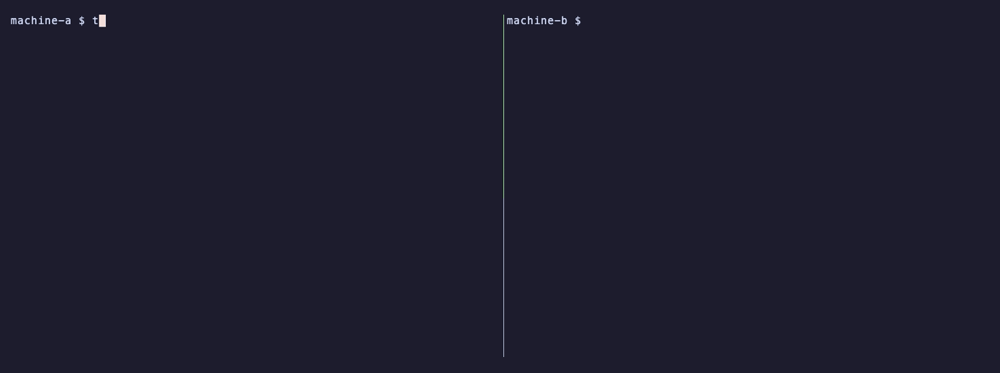

# Tubo

End-to-end encrypted file transfer through a relay, where one of the two
machines doesn't need anything installed except `curl` and `openssl`.

```
sender ──(AES-256-CTR ciphertext)──▶ relay ──▶ receiver
```



The relay forwards bytes between the two sides. The encryption key is part of
the token you share and is never sent to it.

## When this is useful

Tubo is for moving a file between two machines that can't talk to each other
directly, when on one side installing a tool is impractical: a container, a CI
runner, a minimal VM, someone else's laptop. On that side you paste a single
`curl ... | sh` line, or two commands by hand.

If you can already reach one machine from the other over SSH, use `scp` or
`rsync`. If you can install a tool on both ends, [croc](https://github.com/schollz/croc)
and [magic-wormhole](https://github.com/magic-wormhole/magic-wormhole) are more
mature and use a PAKE, so they work with short codes. Tubo doesn't try to
replace either.

## Quick start

Install the CLI (a static Go binary, goes into `~/.local/bin`, no root; the
installer checks it against the release's `checksums.txt`):

```sh
curl -sL https://tubo.endlessite.com/get | sh
```

Send a file. Either side can start; whoever starts prints a token for the
other one:

```sh
$ tubo send backup.sql

Ready! On the other machine run:
  TUBO_TOKEN=k3x9qa-7fh2m0pd-Vb2cQ8xLr0TzWmA4yN1sEe tubo receive

Without tubo installed (needs only curl and openssl):
  curl -sL https://tubo.endlessite.com/run | TUBO_TOKEN=k3x9qa-7fh2m0pd-Vb2cQ8xLr0TzWmA4yN1sEe sh -s receive
```

Other forms:

```sh
tubo send ./project --compress   # directory, streamed as tar.gz
echo "secret" | tubo send -       # from stdin
tubo receive                      # receiver starts and prints the token
tubo receive <token> --stdout     # write to stdout
```

The token can also be passed as an argument (`tubo receive <token>`). On a
machine shared with other users, prefer `TUBO_TOKEN=...`: arguments are
visible to everyone through `ps` while the transfer runs, environment
variables are not.

## Without installing anything

[`run.sh`](run.sh) is about 190 lines of POSIX shell that uses only `curl` and
`openssl` (OpenSSL 1.1.1+ or LibreSSL 2.9+). It is served by the relay at `/run`:

```sh
curl -sL https://tubo.endlessite.com/run | TUBO_TOKEN=<token> sh -s receive [output_file|-]
curl -sL https://tubo.endlessite.com/run | TUBO_TOKEN=<token> sh -s send <file|->
```

You can, and should, download it and read it first:

```sh
curl -sL https://tubo.endlessite.com/run -o run.sh
TUBO_TOKEN=<token> sh run.sh receive
```

When receiving, the file is written to a temporary name and only renamed once
the download completed. A file name chosen by the sender never overwrites an
existing file (`name`, then `name.1`, `name.2`, ...).

`tubo send --manual` and `tubo receive --manual` also print the equivalent
`curl | openssl` pipeline, if you want to do it without any script.

## How it works

The token has three parts, `ID-PASSWORD-KEY`:

| Part | Purpose | Sent to the relay |
|---|---|---|
| `ID` | identifies the session | yes |
| `PASSWORD` | lets the second peer join that session | yes |
| `KEY` | 22 random characters (~131 bits), the end-to-end secret | no |

1. The first peer opens a session; the relay returns `ID` and `PASSWORD`.
2. The peer generates `KEY` locally and prints the token.
3. The second peer joins with `ID` and `PASSWORD`. The relay pairs the two
   connections and forwards data. It keeps nothing on disk.
4. Both sides derive the AES key and IV with
   `PBKDF2-HMAC-SHA256(KEY, no salt, 10000 iterations)`, which is exactly what
   `openssl enc -aes-256-ctr -pbkdf2 -iter 10000 -md sha256 -nosalt` does, so
   the CLI and the shell script interoperate.
5. Between two CLIs, the sender also sends an HMAC-SHA256 of the ciphertext,
   keyed with `SHA-256("tubo-mac-v2:" + KEY)`. The receiver checks it before
   moving the file into place and fails if it doesn't match or is missing.

The CLI talks to the relay over WebSocket, `curl` over plain HTTP(S)
(`GET /<id>` to receive, `POST /<id>` to send). The relay is a single Vert.x
file: [`MainVerticle.java`](server/src/main/java/com/endlessite/server/MainVerticle.java).

## Security: what it does and doesn't protect

- **Contents**: encrypted end to end with AES-256-CTR. The relay can't read them.
- **Integrity between two CLIs**: authenticated with HMAC-SHA256. A modified,
  truncated or corrupted transfer is rejected and nothing is saved.
- **Integrity with `run.sh` / `curl`**: *not* authenticated. `openssl enc`
  has no streaming authenticated mode, so on that path a malicious relay
  could flip bits in the file without being detected. Interrupted transfers
  are still detected.
- **Metadata**: the relay sees the file name, its size, the timing and both
  IP addresses.
- **The token is the secret**: anyone who has it can receive the file. There
  is no PAKE and no confirmation step, so share it over a channel you trust.
- **No audit**: this hasn't been reviewed by anyone but its author. Don't use
  it for anything where that matters.

The public relay at `tubo.endlessite.com` is run by me with no guarantees. If
you don't want to depend on it, run your own (see below).

See [SECURITY.md](SECURITY.md) to report a vulnerability.

## Self-hosting the relay

The simplest way is Docker Compose, which runs the relay behind
[Caddy](https://caddyserver.com) with an automatic Let's Encrypt certificate:

```sh
git clone https://github.com/endlessite/tubo && cd tubo
TUBO_DOMAIN=relay.example.com docker compose up -d --build
```

The domain must point to the machine, and ports 80 and 443 must be open.

Without Docker you need Java 17+ and Maven:

```sh
cd server
mvn package
PORT=8080 java -jar target/tubo-server-1.0.0-fat.jar
```

Point the clients to it:

```sh
tubo config server https://relay.example.com    # saved in ~/.tuborc
export TUBO_SERVER=https://relay.example.com      # or per shell, also read by run.sh
```

Without Docker, put it behind a reverse proxy that terminates TLS. Without TLS the contents
are still encrypted, but the session password travels in clear.

## Compatibility

Since this version the key derivation (PBKDF2 instead of SHA-512) and the
integrity check (HMAC instead of a plaintext SHA-256) changed. CLIs from
`v0.1.0-beta` can't talk to newer ones or to the current `run.sh`: reinstall
on both sides.

## Development

```sh
cd tubo-cli && go test ./... && go build -o tubo .
cd server && mvn package
TUBO_JAR=server/target/tubo-server-1.0.0-fat.jar TUBO_BIN=tubo-cli/tubo sh ci/e2e.sh
```

`ci/e2e.sh` starts a local relay and runs transfers between the CLI and
`run.sh` in every direction (with `dash` when available), including an
interrupted transfer. CI runs the same on every pull request.

`docs/demo.tape` records the demo GIF with [vhs](https://github.com/charmbracelet/vhs)
and tmux, using a real transfer.

Not done yet: resumable transfers, progress percentage on the receiving side,
symlinks inside directories.

## How it was written

The Go client in `tubo-cli/` was generated with AI. `run.sh` was written by
hand with help from AI. Both are covered by the unit tests and by
`ci/e2e.sh`, and the design choices and their limits are described in
[SECURITY.md](SECURITY.md). If something looks wrong, please open an issue.

## License

MIT
